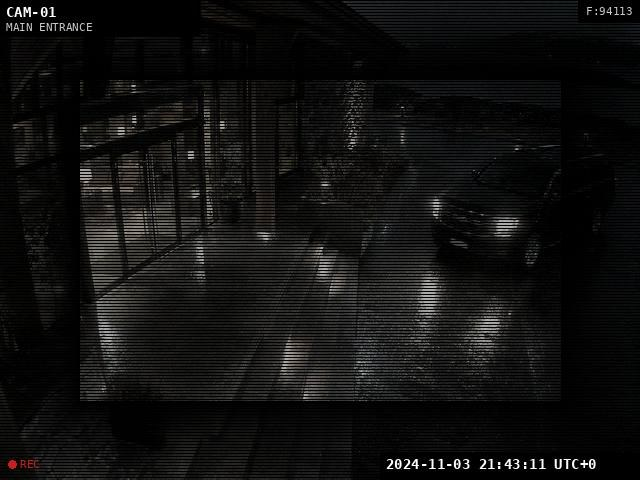
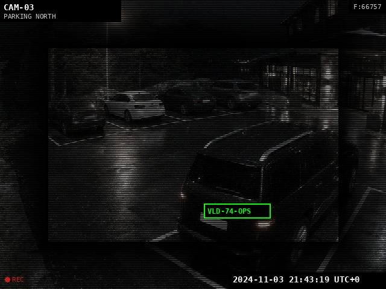
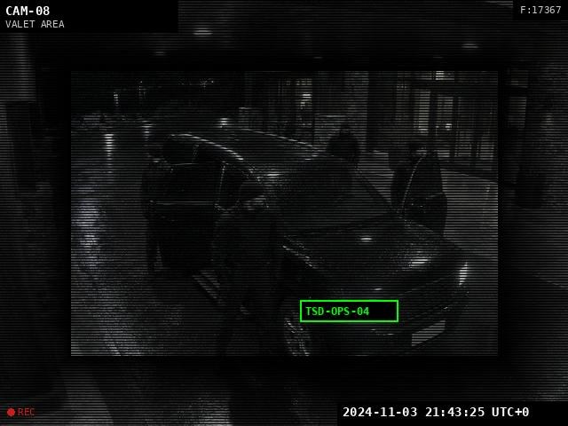
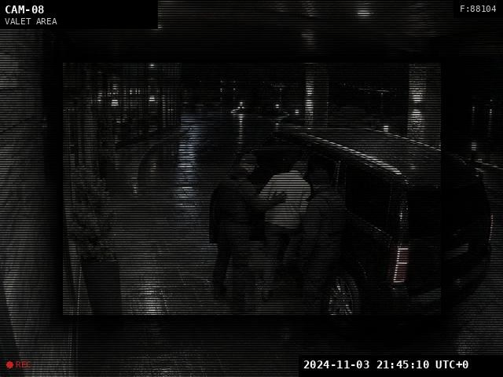

# Invisible Relay — Operation Tervalis, Package 04

## Objective

- **Operation:** TERVALIS (REF NV-OPS-2024-TERV-PKG04, 2024-11-04)
- **Category:** Network / Forensics (multi-sensor correlation + physical surveillance)
- **Initial state:** Endpoint/gateway/transit sensor captures, sensor clock offsets, DNS and firewall event logs, connection inventory, network topology, encrypted `flag_manifest.json` (relay confirmation protocol), hotel CCTV inventory/frames/manifest/VMS events, and legal requisition.
- **Goal:** Identify the relay infrastructure used to intercept Agent AVALD's network traffic, determine the attack vector, and confirm relay origin through cross-correlation of network and physical surveillance evidence.

## Reconnaissance

### Network baseline
- `network_topology.md` / `connection_inventory.csv`: AVALD endpoint `tims` (`10.42.1.5`, endpoint zone) uses the authorized secure relay `relay-01.norveth.vld` / `10.42.1.15:443` (TLS/QUIC relay stream, HTTP status). DNS normally resolves `relay-01.norveth.vld -> 10.42.1.15` (TTL 300) via `10.42.1.2`.

### Sensor timing
- `sensor_clock_offsets.csv`: sensor A (endpoint) offset 0.0s, sensor B (gateway) +3.7s, sensor C (transit) -12.4s (true time = recorded − offset). CCTV offsets (`camera_inventory.csv`, corroborated by VMS `ntp_sync`): CAM-01/05/08 = −340 ms, CAM-02 = 0, CAM-03/04/07 = +1250 ms, CAM-06 = +890 ms (true = recorded/EXIF − `clock_offset_ms`).

### Artifacts reviewed
`sensor_endpoint.csv`, `sensor_gateway.csv`, `sensor_transit.csv`, `dns_events.jsonl`, `firewall_events.csv`, `connection_inventory.csv`, `network_topology.md`, `flag_manifest.json`, `camera_inventory.csv`, `video_manifest.json`, `hotel_vms_events.jsonl`, `requisition.md`, and `hotel_frames/*.jpg` (EXIF).

### Captures CCTV

|  |  |
|:--:|:--:|
| **CAM-01** — entrée principale, 21:43:12 UTC | **CAM-03** — parking nord, 21:43:18 UTC |

|  |  |
|:--:|:--:|
| **CAM-08** — zone voiturier, 21:43:25 UTC | **CAM-08** — zone voiturier, 21:45:10 UTC |


## Analysis

### DNS anomaly (attack enabler)
- Normal: `relay-01.norveth.vld -> 10.42.1.15`, TTL 300.
- Incident: `relay-01.norveth.vld` resolves to **`10.42.3.88`** with **TTL 60** (observed at sensor C ~08:13:50.438Z and sensor B ~08:14:18.401Z recorded), indicating DNS spoofing/poisoning to redirect the relay connection to a DMZ host.

### QUIC path migration / interception
- `10.42.3.88` is `cdn-edge-02` (DMZ/Transit, port 80 per topology) but becomes the QUIC peer for `10.42.1.5:49201` on connection/stream context `QUIC_CID_8B2D`.
- `path_challenge` / `path_response` to `10.42.3.88:443` observed across sensors (clock-normalized):
  - Sensor A (endpoint, 0.0s): `2024-11-03T08:14:16.200Z` (challenge), `08:14:16.230Z` (response)
  - Sensor B (gateway, +3.7s): recorded `08:14:22.615Z/22.645Z` → ≈ `08:14:18.915Z/18.945Z`
  - Sensor C (transit, −12.4s): recorded `08:13:56.583Z/56.613Z` → ≈ `08:14:08.983Z/09.013Z`
- Followed by QUIC stream data and `CONNECTION_CLOSE no_error`, consistent with a DNS-assisted **QUIC connection migration/path hijack** steering AVALD’s relay traffic to the rogue in-path endpoint.

### Relay infrastructure and exfiltration (origin)
- Interception point: **`10.42.3.88`** (impersonated relay endpoint).
- Transit (`sensor_transit.csv`) shows encrypted exfiltration from `10.42.3.88:44301-44303` to **`10.42.5.200:8443`** (TCP) as `enc:aes256gcm:...` payloads (three records: 08:14:10.757Z, 08:14:12.739Z, 08:14:15.712Z transit view), identifying `10.42.5.200` as the relay origin/C2 destination.

## Physical surveillance correlation

- **Window/requisition:** Nordvelt Grand Hotel, 2024-11-03 20:00Z–2024-11-04 02:00Z (NIS-2024-4471 / TRV-2024-1103).
- **Correlated cluster (VMS, 21:43:10Z–21:45:14Z):** coherent arrival → valet/entrance interaction → departure across CAM-03 parking north (entry/exit lanes), CAM-01 main entrance, CAM-08 valet area (high-sensitivity motion/valet events).
- **Key available frames (hash-documented, clock-corrected):**
  - `frame_cam03_214318.jpg` (CAM-03, parking_north, rec/EXIF 21:43:19Z, +1250 ms) → **2024-11-03T21:43:17.750Z**
  - `frame_cam01_214341.jpg` (CAM-01, main_entrance, rec/EXIF 21:43:40Z, −340 ms) → **2024-11-03T21:43:40.340Z** (visual confirmation anchor)
  - `frame_cam08_214325.jpg` (CAM-08, valet_area) → **2024-11-03T21:43:25.340Z**
  - `frame_cam08_214510.jpg` (CAM-08, valet_area) → **2024-11-03T21:45:10.340Z**
  - `frame_cam03_214515.jpg` (CAM-03, exit lane) → **2024-11-03T21:45:14.750Z**
- **Caveats:** CAM-07 offline (maintenance); some frames missing/corrupted per manifest/VMS (e.g. `frame_cam01_214420` corrupted), so correlation used available, verified frames.

## Relay confirmation (`flag_manifest.json`)

- Spec: AES-256-GCM, key = `SHA256("{relay_origin_ip}|{migration_event_utc}|{visual_confirmation_utc}")`, nonce = first 12 bytes of base64-decoded blob, ciphertext+tag remainder.
- Inputs derived from cross-correlation:
  - `relay_origin_ip = 10.42.3.88` (intercept/exfil source tied to origin `10.42.5.200`)
  - `migration_event_utc = 2024-11-03T08:14:16.200Z` (endpoint-observed QUIC path_challenge, sensor A)
  - `visual_confirmation_utc = 2024-11-03T21:43:40.340Z` (CAM-01 `frame_cam01_214341.jpg`, clock-corrected)
- Decryption of the matching transit payload succeeded with these values, yielding the relay confirmation (la valeur soumise, redacted here).

## Commands / steps (reproducible)

```bash
# 1) Inspect artifacts
ls challenge && sed -n '1,200p' challenge/BRIEFING.md challenge/network_topology.md
sed -n '1,40p' challenge/connection_inventory.csv challenge/sensor_clock_offsets.csv challenge/dns_events.jsonl
grep -n "relay-01\|10.42.1.15\|enc:aes256gcm\|QUIC_CID_8B2D\|path_challenge\|10.42.3.88" challenge/dns_events.jsonl challenge/sensor_*.csv

# 2) Normalize sensor times (true = recorded - offset): A=0s, B=+3.7s, C=-12.4s for migration/path events

# 3) CCTV timing: exiftool -DateTimeOriginal challenge/hotel_frames/*.jpg
#    true_utc = recorded/EXIF - clock_offset_ms (from camera_inventory.csv / VMS ntp_sync)

# 4) Confirm protocol: AES-256-GCM, key=SHA256(f"{relay_origin_ip}|{migration_event_utc}|{visual_confirmation_utc}")
#    nonce=blob[:12], ct+tag=blob[12:] over enc:aes256gcm payloads from sensor_transit.csv -> decrypts with values above

# 5) Soumission (valeur non reproduite)